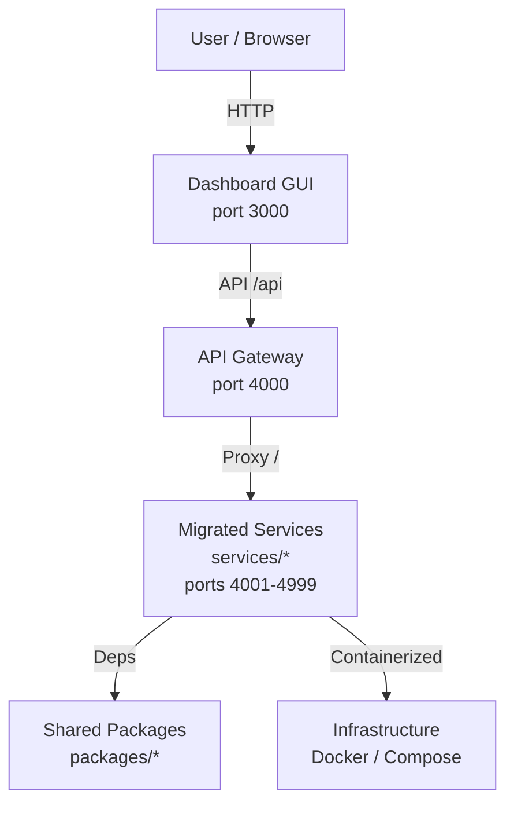

# Architecture — Unified Monorepo

## System Overview



## Component Diagram

```
┌─────────────┐      /api       ┌──────────────┐      /<service>     ┌─────────────┐
│   Browser   │◄───────────────►│  Dashboard   │                     │  Service    │
│  (port 3000)│                 │  (Vite/React)│◄───────────────────►│  (4001-4999)│
└─────────────┘                 └──────┬───────┘       proxy         └─────────────┘
                                      │
                                      │ register/health
                                      ▼
                              ┌─────────────────┐
                              │  API Gateway    │
                              │  (Express, 4000)│
                              │  services.json  │
                              └────────┬────────┘
                                       │
               ┌───────────────────────┼───────────────────────┐
               │                       │                       │
        ┌──────▼──────┐        ┌──────▼──────┐        ┌──────▼──────┐
        │ shared-types│        │ shared-ui   │        │ api-client  │
        │   packages  │        │   packages  │        │   packages  │
        └─────────────┘        └─────────────┘        └─────────────┘
```

## Data Flow

1. User opens the Dashboard at `http://localhost:3000`.
2. Dashboard polls `GET /api/services` → proxied to API Gateway at `http://localhost:4000/services`.
3. Gateway returns the registered service list from `services.json`.
4. User clicks a service → Dashboard navigates to `/<service-name>` → Gateway proxies to the service URL.
5. Health checks poll `GET /health/all` → Gateway aggregates each service's `/health`.

## Key Decisions

| Decision | Rationale |
|----------|-----------|
| **Proxy-based routing** (`/<service-name>` → service URL) | Centralizes routing in one gateway; services keep their own ports and can be started independently. |
| **Preserve original Git history** | Each migrated service keeps `migrated-from-original` branch + remote `origin` pointing at the read-only source. Enables audit and rollback. |
| **Read-only discovery; no overwrite of originals** | Source projects stay untouched. Services are *copied* into `services/` with `MIGRATION.md` markers. Prevents data loss. |
| **`projects.json` as source of truth** | Single inventory file drives consolidation, categorization, migration, and CI/CD. |
| **pnpm workspace** | Shared packages (`shared-types`, `shared-ui`, `api-client`) consumed by dashboard and gateway. |

## Tech Stack

| Component | Technology | Version | Port |
|-----------|------------|---------|------|
| Dashboard | Vite + React | — | 3000 |
| API Gateway | Express + http-proxy-middleware | — | 4000 |
| Shared types | TypeScript | — | — |
| Shared UI | React components | — | — |
| API client | fetch wrapper | — | — |
| Migration scripts | PowerShell 7 | — | — |
| Containerization | Docker + Compose | — | — |

## Directories

```
unified-monorepo/
├── apps/
│   ├── dashboard/          # Frontend GUI (port 3000)
│   └── api-gateway/        # Backend API gateway (port 4000)
├── services/               # Migrated project services (ports 4001-4999)
├── packages/
│   ├── shared-types/
│   ├── shared-ui/
│   └── api-client/
├── infrastructure/
│   └── docker/             # Dockerfiles + docker-compose.yml
├── scripts/
│   ├── discover/           # Scanner, consolidation, categorization
│   ├── migrate/            # Migration, conflict resolution, GitHub init
│   ├── launch/             # Launch-all, stop-all, health-check
│   └── test/               # Test runner
├── docs/                   # Documentation & runbooks
└── docker-compose.yml      # Root orchestration
```
